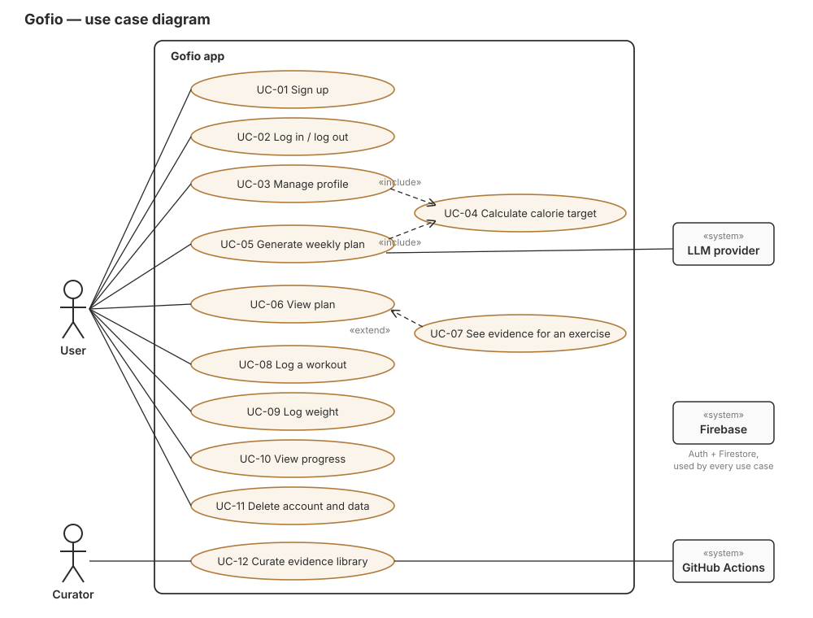

# Use cases

This document defines **what Gofio must do**, from the point of view of the people and systems that use it.
Every feature, screen and test traces back to a use case here. If something isn't here, it isn't in the MVP.

## Actors

| Actor | Type | Description |
| --- | --- | --- |
| **User** | Primary | A person who wants a training and meal plan and to track their progress. Has a phone with Expo Go. |
| **Curator** | Primary | A team member who adds studies and exercises to the evidence library. Works through GitHub, not the app. |
| **LLM provider** | External system | The AI model (Gemini or OpenAI) that arranges a plan from the options we give it. |
| **Firebase** | External system | Authentication and the Firestore database. |
| **GitHub Actions** | External system | Validates evidence data on every pull request. |

## Use case diagram

**Firebase** (Auth + Firestore) supports every use case and is left out of the lines to keep the diagram readable.

«include»: the use case always runs the other one. «extend»: optional behaviour added to another use case.

## Summary

| ID | Use case | Actor | Screen | Issue | Priority |
| --- | --- | --- | --- | --- | --- |
| UC-01 | Sign up | User | 1 | #4, #5 | MVP |
| UC-02 | Log in / log out | User | 1 | #4, #5 | MVP |
| UC-03 | Manage profile | User | 2 | #6 | MVP |
| UC-04 | Calculate calorie target | System | 2 | #7 | MVP |
| UC-05 | Generate weekly plan | User, LLM | 2 → 3 | #8 | MVP |
| UC-06 | View plan | User | 3 | #9 | MVP |
| UC-07 | See evidence for an exercise | User | 6 | #13 | MVP |
| UC-08 | Log a workout | User | 4 | #10 | MVP |
| UC-09 | Log weight | User | 4 | #10 | MVP |
| UC-10 | View progress | User | 5 | #10 | MVP |
| UC-11 | Delete account and data | User | 2 | _to create_ | MVP (GDPR) |
| UC-12 | Curate evidence library | Curator, GitHub Actions | — (GitHub) | #12 | MVP |

Screens are the ones in [docs/design/](design/README.md).

---

## UC-01 Sign up

- **Actor:** User
- **Goal:** create an account to save a profile and plans.
- **Preconditions:** the app is open; the user has no account.
- **Main flow:**
  1. The user enters an email and a password.
  2. The user ticks the consent box for storing health data.
  3. The user taps **Create account**.
  4. The system creates the account in Firebase Auth and saves the consent date.
  5. The system opens the Profile screen (UC-03).
- **Alternative flows:**
  - 2a. Consent not ticked: the button stays disabled and a hint explains why.
  - 4a. Email already registered: the system shows "This email already has an account. Log in?"
  - 4b. Password shorter than 8 characters or invalid email: the system shows the error next to the field.
  - 4c. No network: the system shows "No connection. Try again." and keeps the data typed.
- **Postconditions:** an account exists with `consentAt` saved; the user is logged in.

## UC-02 Log in / log out

- **Actor:** User
- **Preconditions:** the user has an account.
- **Main flow:**
  1. The user enters email and password and taps **Log in**.
  2. The system authenticates with Firebase Auth.
  3. If a plan exists, the system opens the Plan screen with the cached plan; otherwise, the Profile screen.
- **Alternative flows:**
  - 2a. Wrong credentials: "Email or password is incorrect." (Never say which one.)
  - Log out: from Profile, **Log out** ends the session and clears the cached plan.
- **Postconditions:** the user is logged in (or out).

## UC-03 Manage profile

- **Actor:** User
- **Preconditions:** the user is logged in.
- **Main flow:**
  1. The user enters age, sex, height, weight, goal, activity level, training days and allergies.
  2. While typing, the system recalculates the calorie target (includes UC-04).
  3. The user taps **Save and generate my plan**.
  4. The system saves the profile in `users/{uid}` and starts UC-05.
- **Alternative flows:**
  - 1a. Value out of range (age 16–90, height 120–230 cm, weight 30–300 kg): the field shows the valid range; saving is blocked.
  - 1b. Fewer than 1 or more than 6 training days: the system asks for 1–6.
  - 3a. The user edits an existing profile: the system saves it and asks "Regenerate your plan with the new data?"
- **Postconditions:** the profile is stored; the calorie target is up to date.

## UC-04 Calculate calorie target

- **Actor:** System (included in UC-03 and UC-05)
- **Main flow:**
  1. The system computes the basal metabolic rate with Mifflin-St Jeor:
     men `10·kg + 6.25·cm − 5·age + 5`; women `10·kg + 6.25·cm − 5·age − 161`.
  2. It multiplies by the activity factor (1.2 / 1.375 / 1.55 / 1.725).
  3. It adjusts for the goal (lose fat −400 kcal, maintain 0, build muscle +250 kcal).
  4. It applies the safety floor: never below 1,500 kcal (men) or 1,200 kcal (women).
- **Alternative flows:**
  - 4a. The result hits the floor: the system shows the floor value and a note to consult a professional.
- **Postconditions:** a whole-number calorie target. The AI never changes it.

## UC-05 Generate weekly plan

- **Actors:** User, LLM provider
- **Preconditions:** the profile is complete; the evidence library has exercises.
- **Main flow:**
  1. The app calls the `generatePlan` server function with the user's id.
  2. The server reads the profile and calculates the calorie target (includes UC-04).
  3. The server selects the catalog exercises that fit the goal, level and equipment.
  4. The server sends the LLM the profile summary, the calorie target, the allowed exercises and the JSON schema.
  5. The LLM returns a plan as JSON.
  6. The server validates it: schema, only catalog exercise ids, total calories within ±5 % of the target, no declared allergens.
  7. The server saves the plan in `users/{uid}/plans` and returns it.
  8. The app caches the plan and opens the Plan screen (UC-06).
- **Alternative flows:**
  - 5a. The LLM takes longer than 20 s: the server retries once, then returns an error; the app keeps the previous plan.
  - 6a. Invalid JSON or an unknown exercise: the server retries once with the error message; if it fails again, it returns an error.
  - 6b. A meal contains a declared allergen: the server removes it and asks the LLM for a replacement for that meal only.
  - 6c. Calories out of range: the server rejects the plan and retries once.
- **Postconditions:** a valid plan is stored and cached; nothing invalid is ever saved.

## UC-06 View plan

- **Actor:** User
- **Preconditions:** a plan exists.
- **Main flow:**
  1. The user opens the Plan tab.
  2. The system shows the routine for the week as day cards, and the "not medical advice" notice.
  3. The user switches to **Meals** to see today's meals and their calories.
- **Alternative flows:**
  - 2a. No network: the system shows the cached plan with a small "offline" label.
  - 2b. No plan yet: the system shows "Generate your first plan" with a button to UC-05.
- **Extension point:** tapping an exercise (UC-07).

## UC-07 See evidence for an exercise

- **Actor:** User
- **Preconditions:** a plan is shown (extends UC-06).
- **Main flow:**
  1. The user taps an exercise.
  2. The system shows the exercise detail: how-to, muscle groups, today's sets and reps.
  3. The system shows **Why this?** with each linked study: plain-English finding, study type, year, authors.
  4. The user taps **Open study** and the DOI opens in the browser.
- **Alternative flows:**
  - 3a. More than one study: the system shows the strongest one first (meta-analysis > RCT > other) and "+ N more".
- **Postconditions:** none (read-only).

## UC-08 Log a workout

- **Actor:** User
- **Preconditions:** today is a training day in the plan.
- **Main flow:**
  1. On the Log screen, the user taps **Mark as done**.
  2. The system saves `{date, type: "workout", value: dayId}` in `users/{uid}/logs`.
  3. The button changes to "Done ✓" and the weekly summary updates.
- **Alternative flows:**
  - 1a. Rest day: the card says "Rest day" and the button is hidden.
  - 1b. Tapped by mistake: tapping "Done ✓" again undoes it.
- **Postconditions:** the workout is logged once for that day.

## UC-09 Log weight

- **Actor:** User
- **Main flow:**
  1. The user types today's weight and taps **Save weight**.
  2. The system saves `{date, type: "weight", value}`.
  3. The entry appears in the recent list.
- **Alternative flows:**
  - 1a. Out of range (30–300 kg) or not a number: the system shows the error and doesn't save.
  - 2a. A weight already exists for today: the new value replaces it.
- **Postconditions:** at most one weight entry per day.

## UC-10 View progress

- **Actor:** User
- **Main flow:**
  1. The user opens the Progress tab.
  2. The system shows a weight-over-time chart (last 8 weeks), start / now / change, and workouts done this week vs. planned.
- **Alternative flows:**
  - 2a. Fewer than 2 weight entries: the chart shows "Log your weight to see it here".

## UC-11 Delete account and data

- **Actor:** User
- **Preconditions:** the user is logged in.
- **Main flow:**
  1. In Profile, the user taps **Delete my account and data**.
  2. The system explains what will be deleted and asks the user to confirm.
  3. The system deletes `users/{uid}` (profile, plans, logs) and the Auth account.
  4. The app returns to the Sign up screen.
- **Alternative flows:**
  - 2a. The user cancels: nothing changes.
  - 3a. Firebase asks for a recent login: the system asks for the password again, then continues.
- **Postconditions:** no personal data remains (GDPR right to erasure).

## UC-12 Curate evidence library

- **Actors:** Curator, GitHub Actions
- **Preconditions:** the curator has read the study.
- **Main flow:**
  1. The curator creates a branch and adds a JSON file to `data/evidence/` with title, authors, year, journal, DOI, study type, population, a one-sentence finding written by the curator, and tags.
  2. The curator links the study from one or more files in `data/exercises/`.
  3. The curator opens a pull request.
  4. GitHub Actions validates the data: required fields, DOI format, every exercise has at least one study, no broken ids.
  5. A reviewer opens the DOI, checks that the finding matches the paper, and approves.
  6. After merge, the seed script loads the data into Firestore.
- **Alternative flows:**
  - 4a. Validation fails: the PR can't be merged; the curator fixes the file and pushes again.
  - 5a. The finding overstates the study: the reviewer requests changes.
- **Postconditions:** the study and exercises are in the app, with a reviewed PR as their history.

## Non-functional requirements

| ID | Requirement |
| --- | --- |
| NFR-01 | The API key for the LLM never reaches the app (server only). |
| NFR-02 | Users can read and write only their own data (Firestore rules). |
| NFR-03 | A plan is generated in under 20 seconds, or the user gets a clear error. |
| NFR-04 | The last plan is visible without network. |
| NFR-05 | All user-facing text is in English (MVP); no medical claims. |
| NFR-06 | `main` always compiles (CI), and every change is reviewed. |
