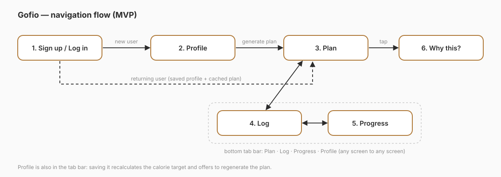
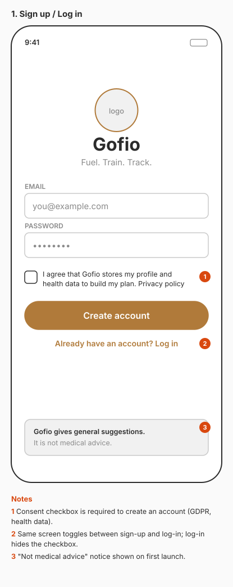
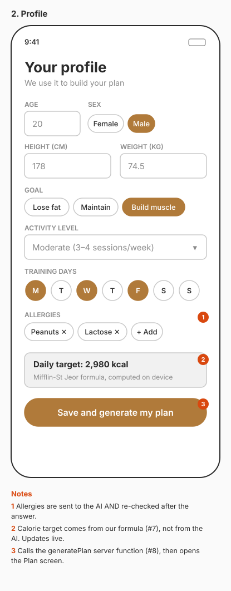
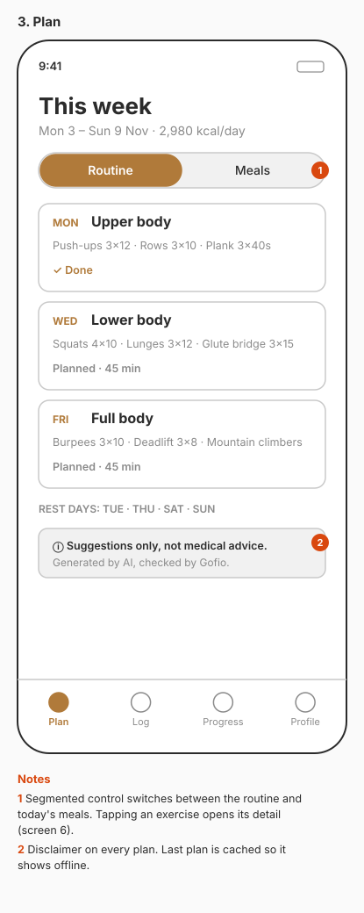
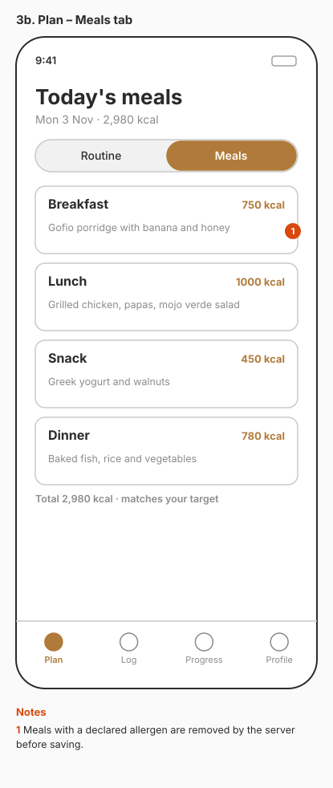
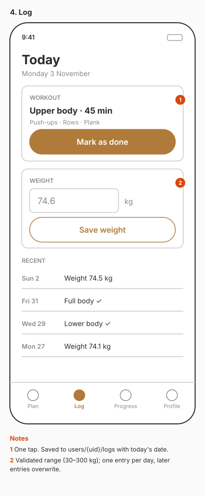
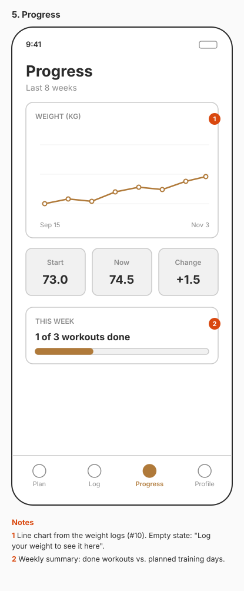
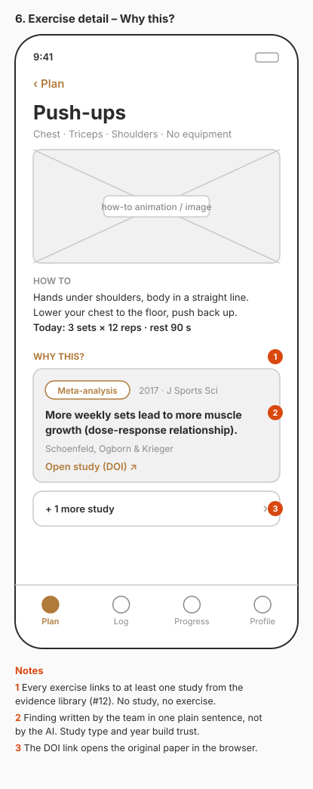

# Screen sketches (low fidelity)

Low-fidelity wireframes for the MVP screens, agreed before any UI code is written (issue #3).
They fix **what each screen shows and where it leads**, not the final look: colours, fonts and icons will change.
Numbered orange markers point to the notes under each phone.

## Navigation

New users go Sign up → Profile → Plan. Returning users open straight on the Plan, using their saved profile and the cached plan. Tapping an exercise opens its detail with the evidence behind it.
After that, a bottom tab bar (Plan · Log · Progress · Profile) moves between screens.

## Screens

| # | Screen | Purpose | Issues |
| --- | --- | --- | --- |
| 1 | [Sign up / Log in](01-sign-up-log-in.svg) | Create an account or log in; GDPR consent; "not medical advice" notice | #4, #5 |
| 2 | [Profile](02-profile.svg) | Data the plan is built from; live calorie target | #6, #7 |
| 3 | [Plan: routine](03-plan.svg) / [meals](03b-plan-meals.svg) | The generated week as cards | #8, #9 |
| 4 | [Log](04-log.svg) | Mark today's workout as done; record weight | #10 |
| 5 | [Progress](05-progress.svg) | Weight chart and weekly summary | #10 |
| 6 | [Exercise detail](06-exercise-detail.svg) | How-to and "Why this?": the study behind the exercise | #12, #13 |

  
  
  

  
  
  

  

## Design decisions

- **One accent colour.** Toasted brown, after gofio. Everything else is grey until we pick a real palette.
- **Evidence is visible.** Every exercise opens a "Why this?" section with the study behind it, its type and year, and a DOI link. The finding is written by the team, not by the AI.
- **Safety is visible.** Consent at sign-up, a "not medical advice" notice on first launch and on every plan, and allergies shown as removable chips.
- **The number the user trusts is ours.** The calorie target on the Profile screen comes from our formula (#7) and updates as the user types. The AI only fills the plan around it.
- **Works offline for the demo.** The Plan screen shows the last cached plan, so a slow network on defense day doesn't leave it empty.
- **Sample data is consistent.** A 20-year-old man, 178 cm, 74.5 kg, moderately active, building muscle: Mifflin-St Jeor gives 1,763 kcal × 1.55 + 250 kcal surplus ≈ 2,980 kcal, and the four meals add up to that.

## Out of scope for these sketches

Onboarding carousel, settings, account deletion flow, dark mode and empty or error states (one example is noted on Progress). We'll add them as separate issues if there's time.

## How to edit

The SVGs are plain text, so Git can diff them. Small changes (a label, a number) can be made in any editor.
For bigger changes, redraw the screen in any tool, export it as SVG with the same file name, and open a pull request.
